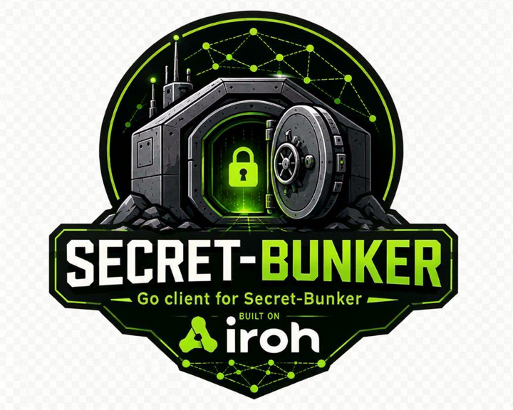

<p align="center">
  
</p>

# go-secret-bunker-iroh

Go client for [secret-bunker-iroh](https://github.com/fables-for-robots/secret-bunker-iroh):
a secrets service reached over [iroh](https://www.iroh.computer) — peer-to-peer
QUIC dialed by public key. Pure Go (no CGO), using the native Go iroh
implementation, upstream [go-iroh](https://github.com/tmc/go-iroh)
(`github.com/tmc/go-iroh`).

The client's identity is its iroh ed25519 key: the server authenticates it
in the QUIC/TLS handshake and authorizes every request against its ACLs.
No certificates, no tokens, no application-layer signing.

## Usage

```go
import (
    "context"

    secretbunker "github.com/fables-for-robots/go-secret-bunker-iroh"
    "github.com/tmc/go-iroh/key"
)

func example(ctx context.Context) error {
    secret, err := key.GenerateSecretKey() // or key.NewSecretKey(seed)
    if err != nil {
        return err
    }
    // Register key.EndpointID(secret.Public()).String() with the bunker's
    // admin, then:
    client, err := secretbunker.Dial(ctx, secret, serverHexID)
    if err != nil {
        return err
    }
    defer client.Close(context.Background())

    if _, err := client.Put(ctx, "prod", "db-password", []byte("hunter2"), 0); err != nil {
        return err
    }
    got, err := client.Get(ctx, "prod", "db-password")
    if err != nil {
        return err // errors.Is(err, secretbunker.ErrDenied), *ConflictError, *FailedError
    }
    _ = got.Value
    return nil
}
```

Without an address, `Dial` finds the bunker by its id, the way the Rust
client does without `--server-addr`: through n0's relays and discovery (DNS
and pkarr), and through mDNS on the local network.
With one or more `"ip:port"` addresses after the id
(`secretbunker.Dial(ctx, secret, serverHexID, "192.0.2.10:4433")`), it dials
those directly and uses neither relays nor lookup, so it works air-gapped.

The full protocol is covered: `Get`, `Put`, `Delete` (compare-and-set
versioning), `List`, `ListGroups`, `GroupACL`, `ListIdentityNames`, and
the admin operations (`CreateGroup`, `AddIdentity`, `RemoveIdentity`,
`SetServiceAdmin`, `ListIdentities`, `Grant`, `RotateDek`). The bunker's
uniform denial surfaces as
`ErrDenied`; CAS failures as `*ConflictError` with the current version.

## Wire format

Messages are CBOR-encoded in serde's externally-tagged enum representation
(unit variants as text strings, others as single-entry maps keyed by the
variant name), matching the Rust server's `proto.rs` name-for-name. The
encoding lives in `proto.go` (via `fxamacker/cbor`) and is pinned by golden
vectors shared with the Rust test suite (`proto_test.go` here,
`wire_format_is_stable` there) — variant and field names are the wire
contract; never rename them. The full protocol spec with annotated CBOR
examples lives in the server repo:
[docs/protocol.md](https://github.com/fables-for-robots/secret-bunker-iroh/blob/main/docs/protocol.md).

## Testing

Unit tests run standalone. The cross-language end-to-end tests drive this
client against the real Rust server (the same suite runs in CI):

```sh
cargo build --manifest-path ../secret-bunker-iroh/Cargo.toml
SECRET_BUNKER_BIN=../secret-bunker-iroh/target/debug/secret-bunker-iroh go test ./...
```

Two more variables steer the tests that dial by id: `SECRET_BUNKER_E2E_RELAY=1`
also runs the one that reaches the bunker through n0's relays (it needs the
internet), and `SECRET_BUNKER_SKIP_MDNS=1` skips the one that finds it by
mDNS, for machines without multicast. When n0's servers are reachable, the
test that a failed `Dial` leaves nothing running takes about half a minute:
it waits for those servers to close the idle HTTP connections that go-iroh's
probes leave behind.

## License

[AGPL-3.0-or-later](LICENSE).
